<!--
  Profile README for github.com/deaflurryth.
  The HERO, LINKS and STACK blocks and everything in assets/ are generated:
  edit profile.config.mjs, then run `node scripts/build.mjs`.
  Everything else in this file is written by hand.
-->

<!-- HERO:START -->
<picture>
  <source media="(prefers-color-scheme: dark) and (max-width: 600px)" srcset="https://raw.githubusercontent.com/deaflurryth/deaflurryth/main/assets/hero/dark-compact.svg">
  <source media="(max-width: 600px)" srcset="https://raw.githubusercontent.com/deaflurryth/deaflurryth/main/assets/hero/light-compact.svg">
  <source media="(prefers-color-scheme: dark)" srcset="https://raw.githubusercontent.com/deaflurryth/deaflurryth/main/assets/hero/dark-wide.svg">
  
</picture>
<!-- HERO:END -->

<!-- LINKS:START -->

  <a href="https://t.me/deaflurryth"><picture><source media="(prefers-color-scheme: dark)" srcset="https://img.shields.io/badge/Telegram-161B22?style=for-the-badge&amp;logo=telegram&amp;logoColor=26A5E4"></picture></a>
  <a href="mailto:amflurry@icloud.com"><picture><source media="(prefers-color-scheme: dark)" srcset="https://img.shields.io/badge/Email-161B22?style=for-the-badge&amp;logo=icloud&amp;logoColor=3693F3"></picture></a>
  <a href="https://itsforge.ru/"><picture><source media="(prefers-color-scheme: dark)" srcset="https://img.shields.io/badge/itsforge.ru-161B22?style=for-the-badge&amp;logo=data%3Aimage%2Fsvg%2Bxml%3Bbase64%2CPHN2ZyB4bWxucz0iaHR0cDovL3d3dy53My5vcmcvMjAwMC9zdmciIHZpZXdCb3g9IjAgMCAyNCAyNCIgZmlsbD0ibm9uZSIgc3Ryb2tlPSIjOEI5NDlFIiBzdHJva2Utd2lkdGg9IjIiIHN0cm9rZS1saW5lY2FwPSJyb3VuZCIgc3Ryb2tlLWxpbmVqb2luPSJyb3VuZCI%2BPGNpcmNsZSBjeD0iMTIiIGN5PSIxMiIgcj0iMTAiLz48cGF0aCBkPSJNMTIgMmExNC41IDE0LjUgMCAwIDAgMCAyMCAxNC41IDE0LjUgMCAwIDAgMC0yMCIvPjxwYXRoIGQ9Ik0yIDEyaDIwIi8%2BPC9zdmc%2B"></picture></a>

<!-- LINKS:END -->

## About

Fullstack engineer with a frontend heart. I build calm, precise interfaces in **Next.js** and **React** — and the **Python** services and **AI agents** behind them. Pixel-level UI is the craft; architecture that holds up is the job.

- 🛰️ Building [**Convergate**](https://convergate.ai) — a B2B sales-intelligence platform: AI research agents, influence maps, generated decks
- 🤖 Agentic pipelines on LangGraph and Pydantic AI, RAG over Qdrant, traced end-to-end with OpenTelemetry
- 🧩 AI-native workflow: Claude Code and Codex with custom skills, review sub-agents and MCP servers
- 🎨 Design systems, tokens and motion — GSAP, Motion and WebGL scenes that hold 60 fps
- 🎣 Off-hours: fishing. Still dreaming of a map with all the best spots

## Stack

<!-- STACK:START -->
<h4>Frontend</h4>

<picture><source media="(prefers-color-scheme: dark)" srcset="https://raw.githubusercontent.com/deaflurryth/deaflurryth/main/assets/icons/dark/typescript.svg">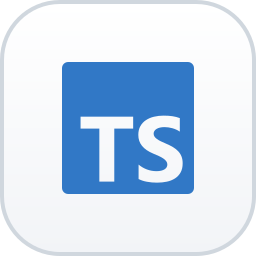</picture>&nbsp;
<picture><source media="(prefers-color-scheme: dark)" srcset="https://raw.githubusercontent.com/deaflurryth/deaflurryth/main/assets/icons/dark/react.svg">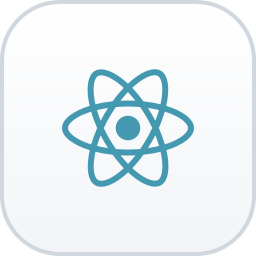</picture>&nbsp;
<picture><source media="(prefers-color-scheme: dark)" srcset="https://raw.githubusercontent.com/deaflurryth/deaflurryth/main/assets/icons/dark/nextdotjs.svg">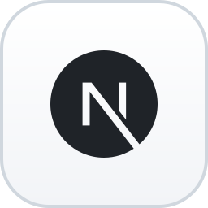</picture>&nbsp;
<picture><source media="(prefers-color-scheme: dark)" srcset="https://raw.githubusercontent.com/deaflurryth/deaflurryth/main/assets/icons/dark/tailwindcss.svg"></picture>&nbsp;
<picture><source media="(prefers-color-scheme: dark)" srcset="https://raw.githubusercontent.com/deaflurryth/deaflurryth/main/assets/icons/dark/css.svg">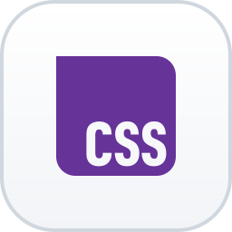</picture>&nbsp;
<picture><source media="(prefers-color-scheme: dark)" srcset="https://raw.githubusercontent.com/deaflurryth/deaflurryth/main/assets/icons/dark/threedotjs.svg">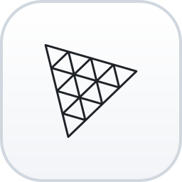</picture>&nbsp;
<picture><source media="(prefers-color-scheme: dark)" srcset="https://raw.githubusercontent.com/deaflurryth/deaflurryth/main/assets/icons/dark/radixui.svg"></picture>&nbsp;
<picture><source media="(prefers-color-scheme: dark)" srcset="https://raw.githubusercontent.com/deaflurryth/deaflurryth/main/assets/icons/dark/shadcnui.svg"></picture>&nbsp;
<picture><source media="(prefers-color-scheme: dark)" srcset="https://raw.githubusercontent.com/deaflurryth/deaflurryth/main/assets/icons/dark/vite.svg"></picture>
 TypeScript · React 19 · Next.js 16 · Tailwind CSS · Modern CSS · Three.js · Radix UI · shadcn/ui · Vite · GSAP · Motion · WebGL · Zustand · Recharts · React Flow · Remotion

<h4>Backend &amp; Data</h4>

<picture><source media="(prefers-color-scheme: dark)" srcset="https://raw.githubusercontent.com/deaflurryth/deaflurryth/main/assets/icons/dark/python.svg">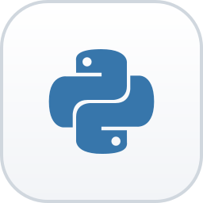</picture>&nbsp;
<picture><source media="(prefers-color-scheme: dark)" srcset="https://raw.githubusercontent.com/deaflurryth/deaflurryth/main/assets/icons/dark/fastapi.svg"></picture>&nbsp;
<picture><source media="(prefers-color-scheme: dark)" srcset="https://raw.githubusercontent.com/deaflurryth/deaflurryth/main/assets/icons/dark/nodedotjs.svg"></picture>&nbsp;
<picture><source media="(prefers-color-scheme: dark)" srcset="https://raw.githubusercontent.com/deaflurryth/deaflurryth/main/assets/icons/dark/prisma.svg">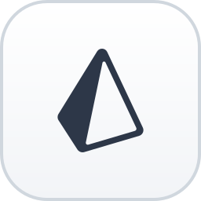</picture>&nbsp;
<picture><source media="(prefers-color-scheme: dark)" srcset="https://raw.githubusercontent.com/deaflurryth/deaflurryth/main/assets/icons/dark/postgresql.svg">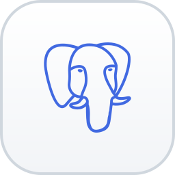</picture>&nbsp;
<picture><source media="(prefers-color-scheme: dark)" srcset="https://raw.githubusercontent.com/deaflurryth/deaflurryth/main/assets/icons/dark/redis.svg"></picture>&nbsp;
<picture><source media="(prefers-color-scheme: dark)" srcset="https://raw.githubusercontent.com/deaflurryth/deaflurryth/main/assets/icons/dark/keycloak.svg">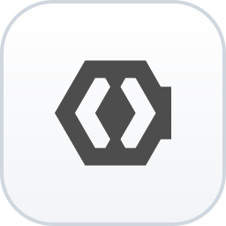</picture>
 Python · FastAPI · Node.js · Prisma · PostgreSQL · Redis · Keycloak · SQLAlchemy · Alembic · Taskiq · Auth.js · S3

<h4>AI &amp; Agentic</h4>

<picture><source media="(prefers-color-scheme: dark)" srcset="https://raw.githubusercontent.com/deaflurryth/deaflurryth/main/assets/icons/dark/claude.svg"></picture>&nbsp;
<picture><source media="(prefers-color-scheme: dark)" srcset="https://raw.githubusercontent.com/deaflurryth/deaflurryth/main/assets/icons/dark/openai.svg">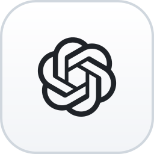</picture>&nbsp;
<picture><source media="(prefers-color-scheme: dark)" srcset="https://raw.githubusercontent.com/deaflurryth/deaflurryth/main/assets/icons/dark/cursor.svg">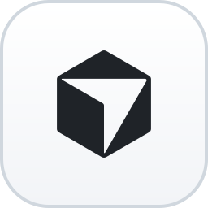</picture>&nbsp;
<picture><source media="(prefers-color-scheme: dark)" srcset="https://raw.githubusercontent.com/deaflurryth/deaflurryth/main/assets/icons/dark/modelcontextprotocol.svg"></picture>&nbsp;
<picture><source media="(prefers-color-scheme: dark)" srcset="https://raw.githubusercontent.com/deaflurryth/deaflurryth/main/assets/icons/dark/langgraph.svg"></picture>&nbsp;
<picture><source media="(prefers-color-scheme: dark)" srcset="https://raw.githubusercontent.com/deaflurryth/deaflurryth/main/assets/icons/dark/pydantic.svg">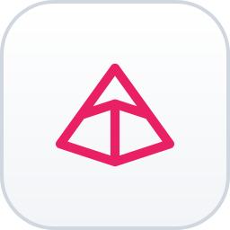</picture>&nbsp;
<picture><source media="(prefers-color-scheme: dark)" srcset="https://raw.githubusercontent.com/deaflurryth/deaflurryth/main/assets/icons/dark/qdrant.svg"></picture>&nbsp;
<picture><source media="(prefers-color-scheme: dark)" srcset="https://raw.githubusercontent.com/deaflurryth/deaflurryth/main/assets/icons/dark/huggingface.svg"></picture>&nbsp;
<picture><source media="(prefers-color-scheme: dark)" srcset="https://raw.githubusercontent.com/deaflurryth/deaflurryth/main/assets/icons/dark/scikitlearn.svg"></picture>
 Claude Code · Codex &amp; OpenAI API · Cursor · MCP · LangGraph · Pydantic AI · Qdrant · Hugging Face · scikit-learn · Context7 · Chrome DevTools MCP · Sentence Transformers · OpenAI-compatible LLMs

<h4>Infra &amp; Observability</h4>

<picture><source media="(prefers-color-scheme: dark)" srcset="https://raw.githubusercontent.com/deaflurryth/deaflurryth/main/assets/icons/dark/docker.svg">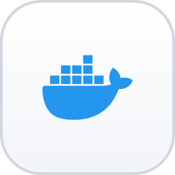</picture>&nbsp;
<picture><source media="(prefers-color-scheme: dark)" srcset="https://raw.githubusercontent.com/deaflurryth/deaflurryth/main/assets/icons/dark/githubactions.svg"></picture>&nbsp;
<picture><source media="(prefers-color-scheme: dark)" srcset="https://raw.githubusercontent.com/deaflurryth/deaflurryth/main/assets/icons/dark/caddy.svg"></picture>&nbsp;
<picture><source media="(prefers-color-scheme: dark)" srcset="https://raw.githubusercontent.com/deaflurryth/deaflurryth/main/assets/icons/dark/nginx.svg">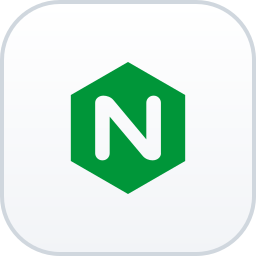</picture>&nbsp;
<picture><source media="(prefers-color-scheme: dark)" srcset="https://raw.githubusercontent.com/deaflurryth/deaflurryth/main/assets/icons/dark/linux.svg"></picture>&nbsp;
<picture><source media="(prefers-color-scheme: dark)" srcset="https://raw.githubusercontent.com/deaflurryth/deaflurryth/main/assets/icons/dark/prometheus.svg"></picture>&nbsp;
<picture><source media="(prefers-color-scheme: dark)" srcset="https://raw.githubusercontent.com/deaflurryth/deaflurryth/main/assets/icons/dark/grafana.svg"></picture>&nbsp;
<picture><source media="(prefers-color-scheme: dark)" srcset="https://raw.githubusercontent.com/deaflurryth/deaflurryth/main/assets/icons/dark/opentelemetry.svg"></picture>&nbsp;
<picture><source media="(prefers-color-scheme: dark)" srcset="https://raw.githubusercontent.com/deaflurryth/deaflurryth/main/assets/icons/dark/jaeger.svg">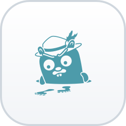</picture>
 Docker · GitHub Actions · Caddy · NGINX · Linux · Prometheus · Grafana · OpenTelemetry · Jaeger · Loki · SearXNG · Umami

<h4>Workflow</h4>

<picture><source media="(prefers-color-scheme: dark)" srcset="https://raw.githubusercontent.com/deaflurryth/deaflurryth/main/assets/icons/dark/git.svg">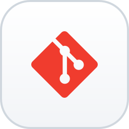</picture>&nbsp;
<picture><source media="(prefers-color-scheme: dark)" srcset="https://raw.githubusercontent.com/deaflurryth/deaflurryth/main/assets/icons/dark/github.svg"></picture>&nbsp;
<picture><source media="(prefers-color-scheme: dark)" srcset="https://raw.githubusercontent.com/deaflurryth/deaflurryth/main/assets/icons/dark/pnpm.svg">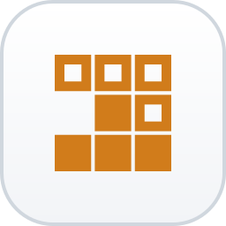</picture>&nbsp;
<picture><source media="(prefers-color-scheme: dark)" srcset="https://raw.githubusercontent.com/deaflurryth/deaflurryth/main/assets/icons/dark/biome.svg"></picture>&nbsp;
<picture><source media="(prefers-color-scheme: dark)" srcset="https://raw.githubusercontent.com/deaflurryth/deaflurryth/main/assets/icons/dark/vitest.svg"></picture>&nbsp;
<picture><source media="(prefers-color-scheme: dark)" srcset="https://raw.githubusercontent.com/deaflurryth/deaflurryth/main/assets/icons/dark/playwright.svg">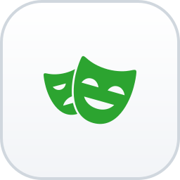</picture>&nbsp;
<picture><source media="(prefers-color-scheme: dark)" srcset="https://raw.githubusercontent.com/deaflurryth/deaflurryth/main/assets/icons/dark/figma.svg"></picture>&nbsp;
<picture><source media="(prefers-color-scheme: dark)" srcset="https://raw.githubusercontent.com/deaflurryth/deaflurryth/main/assets/icons/dark/linear.svg"></picture>&nbsp;
<picture><source media="(prefers-color-scheme: dark)" srcset="https://raw.githubusercontent.com/deaflurryth/deaflurryth/main/assets/icons/dark/obsidian.svg">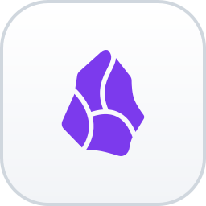</picture>
 Git · GitHub · pnpm · Biome · Vitest · Playwright · Figma · Linear · Obsidian · uv · Ruff · pytest · Stylelint

<!-- STACK:END -->

 

  

